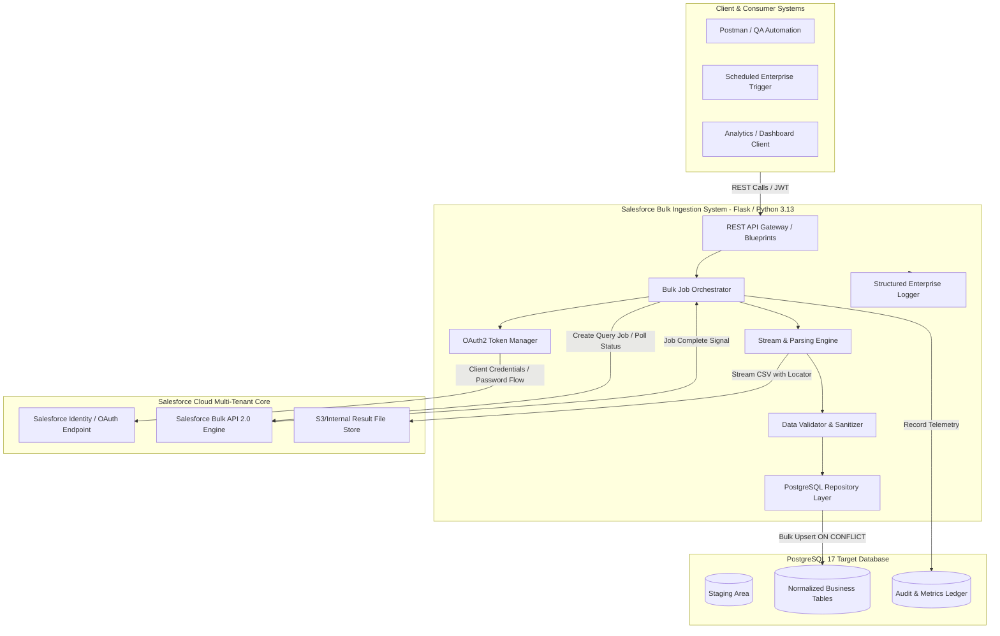

# PHASE 1: REQUIREMENT ANALYSIS & SYSTEM SCOPING
**Project:** Salesforce Bulk API 2.0 Data Ingestion System  
**Document Version:** 1.0.0  
**Classification:** Enterprise Engineering Specification  
**Author:** Principal Software Engineer & Lead Enterprise Systems Architect  
**Target Environment:** Python 3.13 | PostgreSQL 17 | Render Cloud / Enterprise Kubernetes  

---

## 1. Executive Summary & Objective

### 1.1 Business Context
Global enterprises operating Salesforce CRM as their core system of record frequently accumulate tens of millions of transactional, lead, contact, account, and custom object records. Downstream consumer systems—specifically enterprise data warehouses, analytical reporting engines (PowerBI, Tableau), machine learning pipelines, and relational PostgreSQL databases—require near-real-time and batch-synchronized access to this data.

Manual extraction via Salesforce Reports or Data Loader is:
- **Operationally Unscalable:** Manual report exports are constrained by hard limits (e.g., 2,000 rows in standard report UI, 50,000 rows in reports API).
- **Error-Prone & Non-Idempotent:** Human intervention risks data contamination, encoding issues (UTF-8 vs CP1252), and lacks automated deduplication.
- **Resource Inefficient:** Standard REST/SOAP APIs consume excessive API calls (governor limit exhaustion: 1 API call per 2,000 records), leading to quota lockout across other business-critical integrations.

### 1.2 Mission Objective
Design and implement an automated, resilient, fault-tolerant, and secure enterprise-grade **Salesforce Bulk API 2.0 Ingestion Platform** in Python 3.13 and PostgreSQL 17. The platform must:
1. Orchestrate asynchronous Bulk 2.0 query lifecycle (`Create Job` -> `Poll Status` -> `Stream Paginated CSV` -> `Validate & Clean` -> `Upsert to PostgreSQL` -> `Audit & Telemetry`).
2. Provide a clean, robust REST API (Flask, Marshmallow, SQLAlchemy 2.x) to initiate, monitor, abort, and inspect ingestion jobs.
3. Guarantee **idempotency**, zero duplicate inserts, resilient exponential backoff retry semantics, strict rate-limiting compliance, and full auditable traceability.

---

## 2. Theoretical Foundations & Technical Deep-Dive

### 2.1 Salesforce Bulk API 2.0 Mechanics vs Bulk API 1.0 vs Standard REST
| Dimension | Standard REST API | Bulk API 1.0 (Legacy) | Bulk API 2.0 (Modern Enterprise Standard) |
| :--- | :--- | :--- | :--- |
| **Execution Paradigm** | Synchronous | Asynchronous (Batches) | Asynchronous (Server-Optimized Streams) |
| **Batch Management** | N/A (1-2000 records) | Client manually chunks queries into batches (PK Chunking) | Salesforce internally manages parallel chunking and distribution |
| **Daily API Limits** | Consumes standard 24h rolling API call limits | Consumes Bulk 1.0 batch allocation | Dedicated daily limit: **10,000 query jobs per 24 hours** |
| **Result Retrieval** | JSON/XML (Immediate) | Batch-based CSV/XML/JSON retrieval | Paginated CSV via `Sforce-Locator` cursor header (Up to 1 GB per result file) |
| **Network Efficiency** | High overhead (HTTP roundtrips) | Medium overhead | Minimal overhead (Optimal gzip/chunked HTTP/1.1 or HTTP/2 transfer) |
| **Result Retention** | N/A | 7 days | 7 days |

### 2.2 Salesforce Governor Limits & Quota Guardrails
To prevent cluster degradation in a multi-tenant cloud environment, Salesforce imposes strict constraints that our ingestion engine must enforce:
1. **Query Jobs Limit:** Max **10,000 jobs per 24-hour rolling window**. Our system must track query job counts and prevent rogue polling loops from creating runaway jobs.
2. **Query Processing Time:** Max **15 minutes** of query processing time per chunk before query timeout (`QueryTimeout` error). Queries must be optimized with indexed fields (`SystemModstamp`, `CreatedDate`, External IDs).
3. **Result File Size:** Up to **1 GB** uncompressed CSV result per query job. For datasets exceeding 1 GB, Salesforce provides pagination via the `locator` parameter.
4. **Data Storage Window:** Job status and query results are persisted in Salesforce for **7 days**, after which they are permanently deleted.

### 2.3 Idempotency & Upsert Strategy in PostgreSQL
Data pipeline failures (network partitions, worker termination, OOM) must allow safe retries without data corruption.
- **Natural Primary Key:** Salesforce utilizes an 18-character case-insensitive unique identifier (`Id`). All target tables must index `salesforce_id` with a `UNIQUE` constraint.
- **Upsert Semantics:** PostgreSQL 9.5+ `INSERT ... ON CONFLICT (salesforce_id) DO UPDATE SET ...` allows deterministic upserts.
- **Change Data Capture (CDC) / Incremental Sync:** Utilizing `SystemModstamp > :last_sync_timestamp` to minimize ingested payload size and DB write amplification.

---

## 3. Comprehensive Requirements Matrix

### 3.1 Functional Requirements (FR)

| Req ID | Category | Description | Acceptance Criteria | Priority |
| :--- | :--- | :--- | :--- | :--- |
| **FR-01** | Authentication | Authenticate with Salesforce via OAuth 2.0 (Username-Password + Security Token or Connected App JWT Bearer Flow). | Retrieve valid `access_token`, `instance_url`, and cache with automated token refresh upon HTTP 401. | P0 (Critical) |
| **FR-02** | Job Orchestration | Initialize Bulk API 2.0 query jobs for arbitrary SOQL expressions (e.g., `Contact`, `Account`, `Lead`, custom objects). | Send `POST /services/data/vXX.X/jobs/query`; return `job_id`, `state=UploadComplete`. | P0 (Critical) |
| **FR-03** | Status Polling | Poll job status asynchronously with intelligent adaptive backoff. | Check `GET /services/data/vXX.X/jobs/query/{jobId}`; handle `InProgress`, `JobComplete`, `Failed`, `Aborted`. | P0 (Critical) |
| **FR-04** | Stream Ingestion | Stream paginated CSV results without memory exhaustion for multi-gigabyte outputs. | Process streams via chunks (`chunksize` in Pandas or line-by-line streaming) utilizing `Sforce-Locator`. | P0 (Critical) |
| **FR-05** | Validation & Cleansing | Schema enforcement, date-time normalization (ISO-8601 to UTC), phone/email validation, null/empty-string normalization. | Schema validator flags corrupt rows to dead-letter storage; valid records proceed to DB. | P0 (Critical) |
| **FR-06** | Database Upsert | Ingest records into PostgreSQL 17 tables with conflict resolution (`ON CONFLICT`). | New records inserted, existing updated; zero primary key violation crashes; row-level versioning. | P0 (Critical) |
| **FR-07** | Job Audit & Telemetry | Maintain stateful audit ledger of all ingestion runs (`job_runs`, `job_metrics`, `job_errors`). | Exact records extracted, records ingested, records failed, duration, and data throughput recorded. | P1 (High) |
| **FR-08** | REST API Surface | Expose REST endpoints for job dispatch, monitoring, aborting, system health, and metric extraction. | JSON responses with RFC 7807 problem details, standardized status codes (200, 201, 202, 400, 404, 500). | P0 (Critical) |
| **FR-09** | Cancellation & Cleanup | Ability to abort running jobs on Salesforce and cleanly terminate local ingestion pipelines. | Issue `PATCH` to abort job on Salesforce; mark local audit record as `ABORTED`. | P1 (High) |

### 3.2 Non-Functional Requirements (NFR)

| Req ID | Category | Target Metric / Requirement | Architectural Mechanism |
| :--- | :--- | :--- | :--- |
| **NFR-01** | Performance & Throughput | Ingest 500,000 records in < 5 minutes (network bound). | Batched PostgreSQL upserts using `psycopg2` / `pgcopy` or bulk chunked executions. |
| **NFR-02** | Memory Footprint | Max heap memory usage < 512 MB regardless of CSV size (10 MB to 10 GB). | Streaming HTTP response to disk/generator; streaming Pandas chunking (`chunksize=10,000`). |
| **NFR-03** | Reliability & Resilience | 99.9% ingestion job success rate over transient network faults. | Tenacity/Urllib3 exponential backoff with jitter (Decorrelated Jitter algorithm). |
| **NFR-04** | Security & Compliance | Zero plaintext secrets in codebase or VCS; OAuth tokens stored only in-memory or encrypted; TLS 1.3. | Environment-driven config via `python-dotenv` & validation via Pydantic/dataclass; masked log outputs. |
| **NFR-05** | Maintainability & Clean Code | 100% adherence to Clean Architecture, SOLID principles, PEP8, strict typing. | Distinct Layering (Route -> Controller -> Service -> Repository -> Model). |
| **NFR-06** | Testability | > 85% Code Coverage across Unit, Integration, and Contract tests. | Pytest suite with Salesforce API mocks (`responses` / `unittest.mock`) and test DB containers. |
| **NFR-07** | Observability | Structured JSON logging with Correlation ID (`X-Correlation-ID`) across all request threads. | Custom Python Logging Formatter with Rotating File Handlers & Stream Handler. |

---

## 4. Architectural Decision Records (ADR)

### ADR-01: Adoption of Salesforce Bulk API 2.0 over Bulk API 1.0
- **Context:** Salesforce offers Bulk API 1.0 and Bulk API 2.0. Bulk 1.0 requires manual batch partitioning and PK Chunking configuration. Bulk 2.0 automatically optimizes query chunking on the server side and operates under simplified 24-hour limits.
- **Decision:** Exclusively adopt Bulk API 2.0 (`/services/data/vXX.X/jobs/query`).
- **Consequence:** Eliminates complex client-side chunk management; integrates cleanly with standard modern pagination (`Sforce-Locator`).

### ADR-02: Framework Selection — Flask with Application Factory & Blueprints
- **Context:** The system requires a microservice REST API that is lightweight, deterministic, and supports background task orchestration and modular extension.
- **Decision:** Utilize Flask 3.x with Application Factory Pattern (`create_app`), Blueprint routing, SQLAlchemy 2.0 ORM, and Flask-Migrate (Alembic).
- **Consequence:** Clean separation of concerns without heavyweight enterprise overhead; full compatibility with Python 3.13 and modern async/threaded execution.

### ADR-03: Data Ingestion Strategy — Chunked Streaming with Staging Upsert
- **Context:** Downloading multi-gigabyte CSV files into memory causes Python `MemoryError` and OOM kills in containerized environments (e.g., Render 512MB RAM limits).
- **Decision:** Stream HTTP response to disk/temporary scratch storage, parse via Pandas in fixed chunks (`10,000 rows`), validate in memory, and execute batched upsert (`INSERT ... ON CONFLICT`) in PostgreSQL.
- **Consequence:** Predictable, constant memory profile ($O(1)$ space complexity relative to dataset size).

### ADR-04: Resilient Polling — Exponential Backoff with Jitter
- **Context:** Salesforce Bulk query jobs take between 5 seconds and 15 minutes to compile and execute depending on org volume and server load. Constant rapid polling exhausts API limits.
- **Decision:** Implement exponential backoff starting at 2 seconds, multiplying by 1.5 up to a maximum interval of 30 seconds, augmented with randomized jitter.
- **Consequence:** Drastically reduces unnecessary API requests while minimizing idle latency once jobs transition to `JobComplete`.

---

## 5. System Boundary & Interface Specifications

---

## 6. Target Data Entities Scope (Initial & Extensible)
The architecture must natively support core CRM entities while providing an extensible schema-driven mapping framework:
1. **Salesforce Account (`Account`)** -> Target: `sf_accounts`
   - Attributes: `Id`, `Name`, `AccountNumber`, `Type`, `Industry`, `AnnualRevenue`, `Phone`, `Website`, `BillingCity`, `BillingCountry`, `CreatedDate`, `SystemModstamp`.
2. **Salesforce Contact (`Contact`)** -> Target: `sf_contacts`
   - Attributes: `Id`, `AccountId`, `FirstName`, `LastName`, `Email`, `Phone`, `Title`, `Department`, `LeadSource`, `CreatedDate`, `SystemModstamp`.
3. **Salesforce Opportunity (`Opportunity`)** -> Target: `sf_opportunities`
   - Attributes: `Id`, `AccountId`, `Name`, `StageName`, `Amount`, `Probability`, `CloseDate`, `Type`, `CreatedDate`, `SystemModstamp`.
4. **Ingestion Audit Ledgers**
   - `bulk_ingestion_jobs`: Master record of all triggered Bulk API jobs, parameters, SOQL, state, start/end timestamps.
   - `bulk_ingestion_batches`: Batch-level tracking (locator pagination, byte count, row count, execution time).
   - `bulk_ingestion_errors`: Granular row-level rejection logs with exact Salesforce ID and validation failure message.

---

## 7. Risk Analysis & Mitigation Matrix

| Identified Risk | Severity | Probability | Mitigation Strategy |
| :--- | :--- | :--- | :--- |
| **Salesforce API Limit Exhaustion** | Critical | Medium | Centralized rate-limit tracker; respect `Sforce-Limit-Info` response headers; abort redundant pollers. |
| **Container OOM (Out of Memory) on Render** | High | High | Enforce chunked HTTP streaming directly to disk; chunked CSV reading (`chunksize=10000`). Never load full CSV to RAM. |
| **Transient Network Breakage during 2GB CSV Download** | High | Medium | HTTP range headers / stream resumption; retry mechanics with byte offset verification. |
| **Dirty Data / Type Coercion Crashes** | High | High | Pydantic / Schema validation layer prior to database insertion; dead-letter logging for corrupt rows. |
| **Clock Drift & Race Conditions in Incremental Sync** | Medium | Low | Use Salesforce `SystemModstamp` (database commit timestamp) instead of `LastModifiedDate`. |

---

## 8. Verification & Acceptance Criteria for Phase 1
- [x] Comprehensive business context and technical drivers documented.
- [x] Functional Requirements (FR-01 through FR-09) and Non-Functional Requirements (NFR-01 through NFR-07) formally specified.
- [x] Architectural Decision Records (ADRs) established for Framework, API version, Streaming, and Resilience.
- [x] Architectural boundary and sequence interactions defined via Mermaid diagrams.
- [x] Risk and Mitigation Matrix finalized for enterprise deployment.
