# PHASE 2: ENTERPRISE SYSTEM DESIGN SPECIFICATION
**Project:** Salesforce Bulk API 2.0 Data Ingestion System  
**Document Version:** 2.0.0  
**Classification:** Enterprise Engineering Architecture Document  
**Status:** Approved for Implementation Blueprint  
**Target Environment:** Python 3.13 | Flask 3.x | SQLAlchemy 2.0 | PostgreSQL 17 | Docker | Render Cloud  

---

## 1. Executive Summary

The **Salesforce Bulk API 2.0 Data Ingestion System** is an enterprise-grade, asynchronous, high-throughput microservice platform designed to extract high-volume data (HVD) from Salesforce multi-tenant infrastructure and load it deterministically into a normalized PostgreSQL 17 data warehouse.

The system addresses the operational bottlenecks of manual exports and synchronous REST APIs by:
- Operating under strict compliance with Salesforce Bulk API 2.0 limits (10,000 query jobs per 24 hours).
- Enforcing constant memory complexity ($O(1)$ RAM usage, $<512\text{ MB}$ footprint) through chunked streaming HTTP pipelines and chunked CSV parsing.
- Ensuring strict idempotency via PostgreSQL 17 `INSERT ... ON CONFLICT (salesforce_id) DO UPDATE`upsert semantics.
- Providing an enterprise REST API surface with end-to-end request correlation, structured JSON logging, and comprehensive audit ledgers.

---

## 2. High-Level Architecture

The system is decoupled into four primary horizontal tiers:
1. **Edge & Ingress Tier:** Receives operational REST commands, injects unique correlation IDs (`X-Correlation-ID`), validates payloads against Marshmallow schemas, and manages authentication.
2. **Core Ingestion Orchestration Tier:** Manages the lifecycle of Salesforce Bulk API 2.0 query jobs, executes asynchronous polling with decorrelated jitter, and coordinates worker pipelines.
3. **Stream Transformation & Cleansing Pipeline:** Consumes streaming gzip CSV payloads directly from Salesforce storage endpoints, cleans and casts data in 10,000-row chunks, applies domain validation rules, and isolates corrupt records into a dead-letter ledger.
4. **Enterprise Persistence Tier:** PostgreSQL 17 database storing normalized business CRM records (`sf_accounts`, `sf_contacts`, `sf_opportunities`) alongside job telemetry and row-level error audit logs.

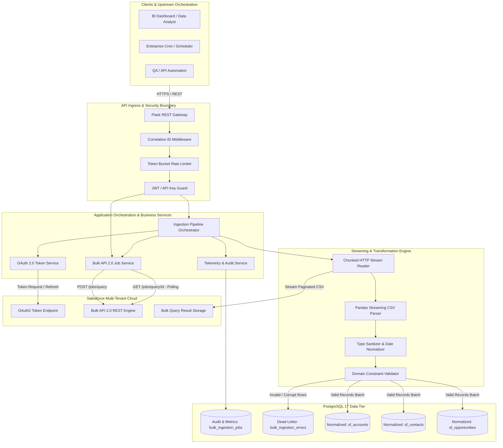

---

## 3. Clean Architecture Design

The architecture enforces strict **Dependency Inversion** and **Separation of Concerns**. Dependencies point strictly inwards toward domain models and abstractions.

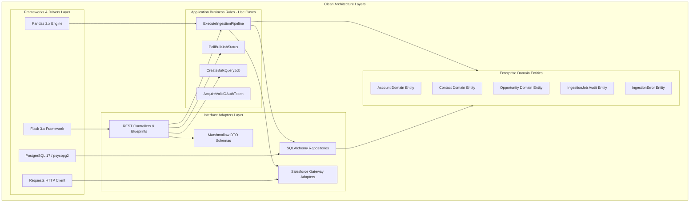

---

## 4. Layer Responsibilities & Module Boundaries

### 4.1 Presentation Layer (`app/api/`)
- **Blueprints & Routes:** Exposes HTTP endpoints (`/health`, `/metrics`, `/login`, `/bulk/jobs`, `/ingest`, `/logs`).
- **Middlewares:** Intercepts incoming requests to extract/generate `X-Correlation-ID`, measures request latency, and enforces global exception handling.
- **DTO Serialization / Marshmallow Schemas:** Validates incoming JSON query parameters and bodies; serializes outgoing responses conforming to RFC 7807 (Problem Details for HTTP APIs).

### 4.2 Controller Layer (`app/api/routes/`)
- Acts as a thin orchestration layer between HTTP requests and the Service Layer.
- Translates HTTP inputs into typed Python dataclasses/DTOs.
- Never directly accesses the database or executes raw HTTP requests to Salesforce.

### 4.3 Service Layer (`app/services/`)
- **Business Logic Boundary:** Implements use cases (`AuthService`, `BulkService`, `IngestionService`, `AuditService`).
- Manages transactional boundaries (`Unit of Work`).
- Coordinates between Salesforce client gateways and database repositories.

### 4.4 Repository Layer (`app/database/repositories/`)
- Implements the **Repository Pattern** (`AccountRepository`, `ContactRepository`, `OpportunityRepository`, `JobAuditRepository`).
- Encapsulates all SQLAlchemy queries and native PostgreSQL 17 execution logic.
- Abstracts data persistence so business logic remains agnostic of the underlying database engine.

### 4.5 Database Layer (`app/database/`)
- Manages PostgreSQL connection pooling (`pool_size=10`, `max_overflow=20`, `pool_recycle=1800`).
- Houses SQLAlchemy declarative models, migration histories (Alembic), and custom SQL execution utilities (`COPY`, `ON CONFLICT`).

### 4.6 External API Layer (`app/salesforce/`)
- Low-level resilient HTTP client wrapping `requests.Session` with custom retry adapters.
- Manages OAuth 2.0 token lifecycle, token caching, and thread-safe automatic token refresh on HTTP 401.
- Implements the Bulk API 2.0 protocol: query submission, status polling, and stream consumption.

---

## 5. Complete Enterprise Folder Structure

```
Salesforce Bulk API Data Ingestion System/
│
├── .env.example                               # Environment configuration template
├── .gitignore                                 # Git exclusions for Python, IDEs, and artifacts
├── Dockerfile                                 # Multi-stage production container build
├── docker-compose.yml                         # Local multi-container stack (App + PostgreSQL 17)
├── requirements.txt                           # Production dependencies (pinned)
├── requirements-dev.txt                       # Development, linting, and testing dependencies
├── run.py                                     # WSGI application entry point (Gunicorn/Flask)
│
├── app/                                       # Core Application Package
│   ├── __init__.py                            # Application Factory (create_app)
│   ├── config.py                              # Typed configuration classes (Dev, Test, Prod)
│   │
│   ├── common/                                # Cross-Cutting Concerns
│   │   ├── __init__.py
│   │   ├── constants.py                       # System enums, HTTP status codes, SF endpoints
│   │   ├── exceptions.py                      # Enterprise exception hierarchy
│   │   ├── logging.py                         # Structured JSON logger & rotating handlers
│   │   └── telemetry.py                       # Prometheus/In-memory metrics collectors
│   │
│   ├── core/                                  # Domain Core Abstractions
│   │   ├── __init__.py
│   │   ├── base_repository.py                 # Generic Base Repository Interface
│   │   └── base_service.py                    # Generic Base Service Interface
│   │
│   ├── database/                              # Persistence Engine
│   │   ├── __init__.py                        # Engine initialization and scoped session
│   │   ├── connection.py                      # Session lifecycle & context managers
│   │   ├── models/                            # SQLAlchemy ORM Models
│   │   │   ├── __init__.py
│   │   │   ├── account.py                     # sf_accounts table model
│   │   │   ├── contact.py                     # sf_contacts table model
│   │   │   ├── opportunity.py                 # sf_opportunities table model
│   │   │   ├── ingestion_job.py               # bulk_ingestion_jobs table model
│   │   │   └── ingestion_error.py             # bulk_ingestion_errors table model
│   │   ├── repositories/                      # Concrete Repositories
│   │   │   ├── __init__.py
│   │   │   ├── account_repo.py
│   │   │   ├── contact_repo.py
│   │   │   ├── opportunity_repo.py
│   │   │   └── job_audit_repo.py
│   │   └── migrations/                        # Alembic Database Migrations
│   │
│   ├── salesforce/                            # Salesforce Cloud Integration
│   │   ├── __init__.py
│   │   ├── client.py                          # Authenticated HTTP session & retry adapter
│   │   ├── oauth.py                           # OAuth 2.0 token manager & refresh mutex
│   │   ├── bulk_query.py                      # Bulk API 2.0 query lifecycle client
│   │   └── stream_reader.py                   # Generator-based chunked CSV stream reader
│   │
│   ├── pipeline/                              # High-Volume Data Processing Engine
│   │   ├── __init__.py
│   │   ├── parser.py                          # Chunked CSV parser (Pandas chunksize)
│   │   ├── transformer.py                     # Type casting, UTC timestamp normalization
│   │   ├── validator.py                       # Schema enforcement & row quarantine
│   │   └── loader.py                          # High-throughput PostgreSQL batch loader
│   │
│   ├── api/                                   # REST Presentation Layer
│   │   ├── __init__.py
│   │   ├── middlewares/                       # Request Interceptors
│   │   │   ├── __init__.py
│   │   │   ├── correlation.py                 # Correlation ID (X-Correlation-ID) injector
│   │   │   └── error_handler.py               # Global RFC 7807 error translator
│   │   ├── schemas/                           # Marshmallow Serialization Schemas
│   │   │   ├── __init__.py
│   │   │   ├── auth_schema.py                 # Login and token DTOs
│   │   │   ├── job_schema.py                  # Bulk job request/response DTOs
│   │   │   └── ingest_schema.py               # Ingest trigger and summary DTOs
│   │   └── routes/                            # Route Blueprints
│   │       ├── __init__.py
│   │       ├── health_routes.py               # /health, /metrics
│   │       ├── auth_routes.py                 # /login, /refresh
│   │       ├── bulk_routes.py                 # /bulk/jobs, /bulk/jobs/{id}, /bulk/results/{id}
│   │       └── ingest_routes.py               # /ingest, /logs
│   │
│   └── services/                              # Application Service Layer
│       ├── __init__.py
│       ├── auth_service.py                    # Authentication orchestrator
│       ├── bulk_service.py                    # Bulk 2.0 query job service
│       └── ingestion_service.py               # Complete ingestion pipeline service
│
├── docs/                                      # Enterprise Documentation & Specifications
│   ├── architecture/                          # Architecture diagrams & threat models
│   ├── api/                                   # OpenAPI 3.0 specs & Postman collections
│   └── phases/                                # Phased engineering documents
│       ├── 01_REQUIREMENT_ANALYSIS.md         # Phase 1 Specification
│       └── 02_SYSTEM_DESIGN.md                # Phase 2 System Design Document (This file)
│
├── scripts/                                   # Operational, Migration & Verification Tooling
│   ├── verify_phase1_requirements.py          # Phase 1 verification script
│   ├── verify_phase2_design.py                # Phase 2 verification script
│   ├── seed_database.py                       # PostgreSQL seed data generator
│   └── run_migrations.py                      # Database migration runner
│
└── tests/                                     # Automated Test Suite (Pytest)
    ├── conftest.py                            # Pytest fixtures and mock factories
    ├── unit/                                  # Pure Unit Tests
    ├── integration/                           # Integration Tests (PostgreSQL + Mocked SF)
    └── api/                                   # End-to-End API Route Tests
```

---

## 6. Module Responsibilities Matrix

| Module | Core Classes / Artifacts | Architectural Responsibility |
| :--- | :--- | :--- |
| `app.config` | `Config`, `ProductionConfig` | Immutable, typed environment configuration loaded via `python-dotenv`. |
| `app.common.logging` | `JSONFormatter`, `EnterpriseLogger` | Rotating file & stdout structured JSON logging with correlation IDs. |
| `app.common.exceptions` | `SalesforceAPIError`, `DataValidationError` | Custom domain exception taxonomy with HTTP status code mappings. |
| `app.salesforce.oauth` | `SalesforceOAuthManager` | Thread-safe OAuth 2.0 token acquisition, caching, and auto-refresh. |
| `app.salesforce.bulk_query`| `SalesforceBulkClient` | Creates query jobs, polls status with backoff, aborts jobs. |
| `app.salesforce.stream_reader`| `BulkStreamReader` | Streams multi-gigabyte CSV results via chunked HTTP generators. |
| `app.pipeline.parser` | `StreamingCSVParser` | Parses raw CSV streams into chunked Pandas DataFrames. |
| `app.pipeline.transformer`| `DataTransformer` | Normalizes types, coerces ISO dates to UTC, scrubs control characters. |
| `app.pipeline.validator` | `SchemaValidator` | Validates mandatory fields; diverts corrupt rows to dead-letter storage. |
| `app.pipeline.loader` | `PostgreSQLLoader` | Executes high-throughput batched `ON CONFLICT DO UPDATE` operations. |
| `app.database.repositories`| `AccountRepository`, etc. | Abstract data access layer encapsulating all SQLAlchemy persistence. |
| `app.services.ingestion_service`| `IngestionService` | Master pipeline orchestrator coordinating SF, pipeline, and DB layers. |

---

## 7. Component Diagram

```mermaid
component
    package "Flask Presentation Tier" {
        [REST API Controllers] as Controllers
        [Marshmallow Schemas] as Schemas
        [Correlation Middleware] as CorrMW
    }

    package "Application Core" {
        [Ingestion Service] as IngestSvc
        [Bulk Query Service] as BulkSvc
        [OAuth Service] as AuthSvc
    }

    package "Salesforce Integration Client" {
        [OAuth Token Manager] as OAuthMgr
        [Bulk 2.0 Query Client] as BulkClient
        [Streaming HTTP Reader] as StreamReader
    }

    package "Data Pipeline Engine" {
        [Chunked CSV Parser] as Parser
        [Data Transformer] as Transformer
        [Dead-Letter Filter] as Validator
        [Batch Upsert Loader] as Loader
    }

    package "PostgreSQL 17 Persistence" {
        [Account Repository] as AccRepo
        [Contact Repository] as ContRepo
        [Job Audit Repository] as AuditRepo
        database "PostgreSQL 17 Database" as DB
    }

    Controllers --> Schemas
    Controllers --> IngestSvc
    Controllers --> BulkSvc
    
    IngestSvc --> AuthSvc
    IngestSvc --> BulkSvc
    IngestSvc --> StreamReader
    IngestSvc --> Parser
    IngestSvc --> Transformer
    IngestSvc --> Validator
    IngestSvc --> Loader
    IngestSvc --> AuditRepo

    AuthSvc --> OAuthMgr
    BulkSvc --> BulkClient
    
    Loader --> AccRepo
    Loader --> ContRepo
    AccRepo --> DB
    ContRepo --> DB
    AuditRepo --> DB
```

---

## 8. Detailed Sequence Diagrams

### 8.1 Authentication Sequence (OAuth 2.0 with Token Auto-Refresh)
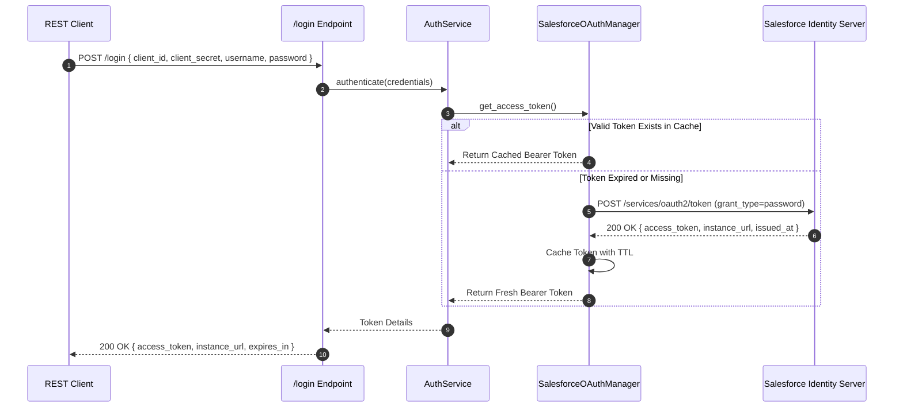

### 8.2 Create Bulk Query Job Sequence
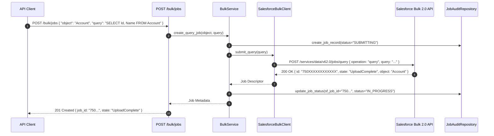

### 8.3 Poll Job Status Sequence (Adaptive Backoff)
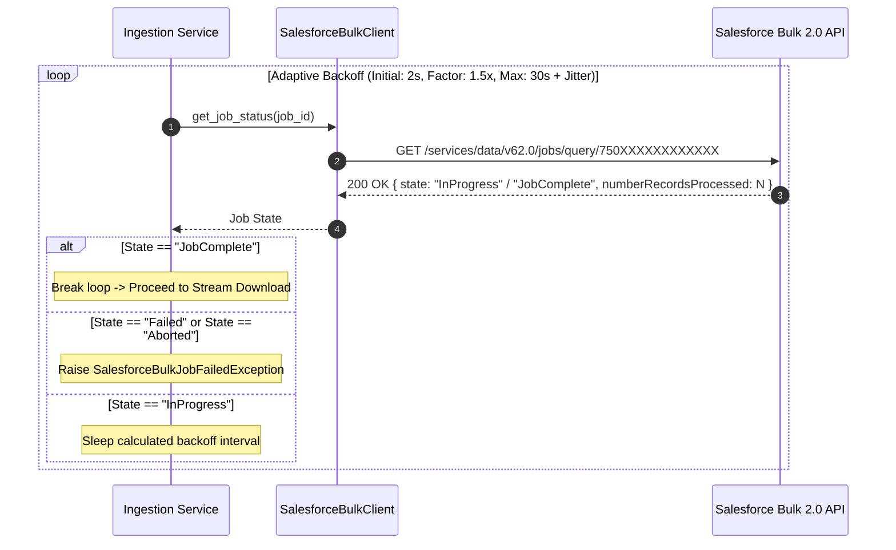

### 8.4 Download CSV Stream Sequence (Paginated with Locator)
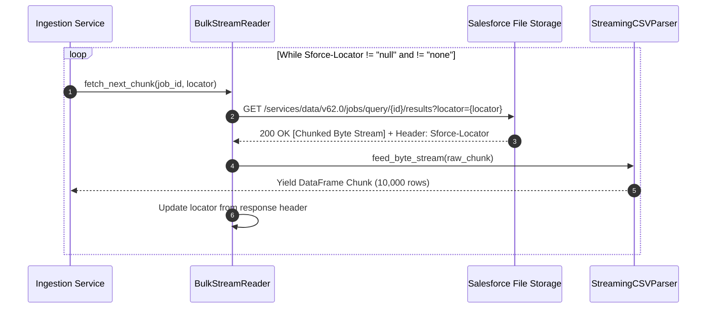

### 8.5 Validate Data & Dead-Letter Quarantine Sequence
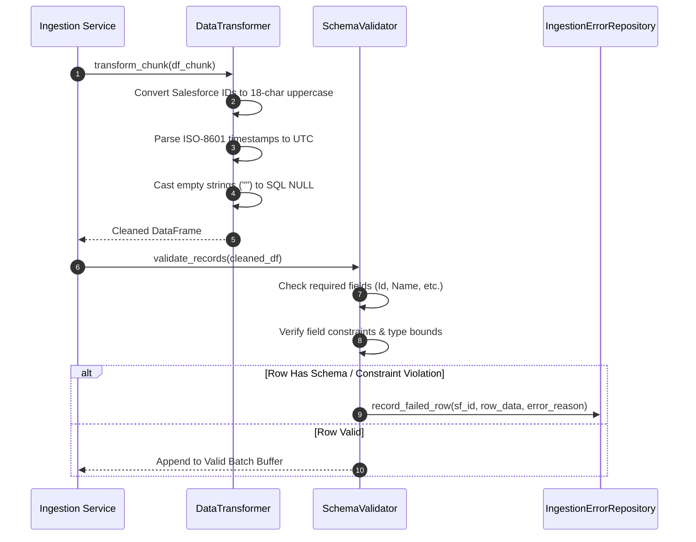

### 8.6 PostgreSQL Batched Upsert Sequence (`ON CONFLICT`)
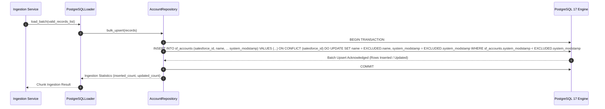

---

## 9. Comprehensive Database Design

### 9.1 Relational Architecture & Normalization
The database is structured in **Third Normal Form (3NF)** for CRM business entities, supplemented by dedicated telemetry and audit ledgers:
- **`bulk_ingestion_jobs`**: Master audit record for every Bulk API job run.
- **`bulk_ingestion_errors`**: Dead-letter quarantine table storing individual rejected records with detailed diagnostics.
- **`sf_accounts`**: Normalized Salesforce Account records.
- **`sf_contacts`**: Normalized Salesforce Contact records linked via `account_id`.
- **`sf_opportunities`**: Normalized Salesforce Opportunity records linked via `account_id`.

### 9.2 Entity-Relationship (ER) Diagram
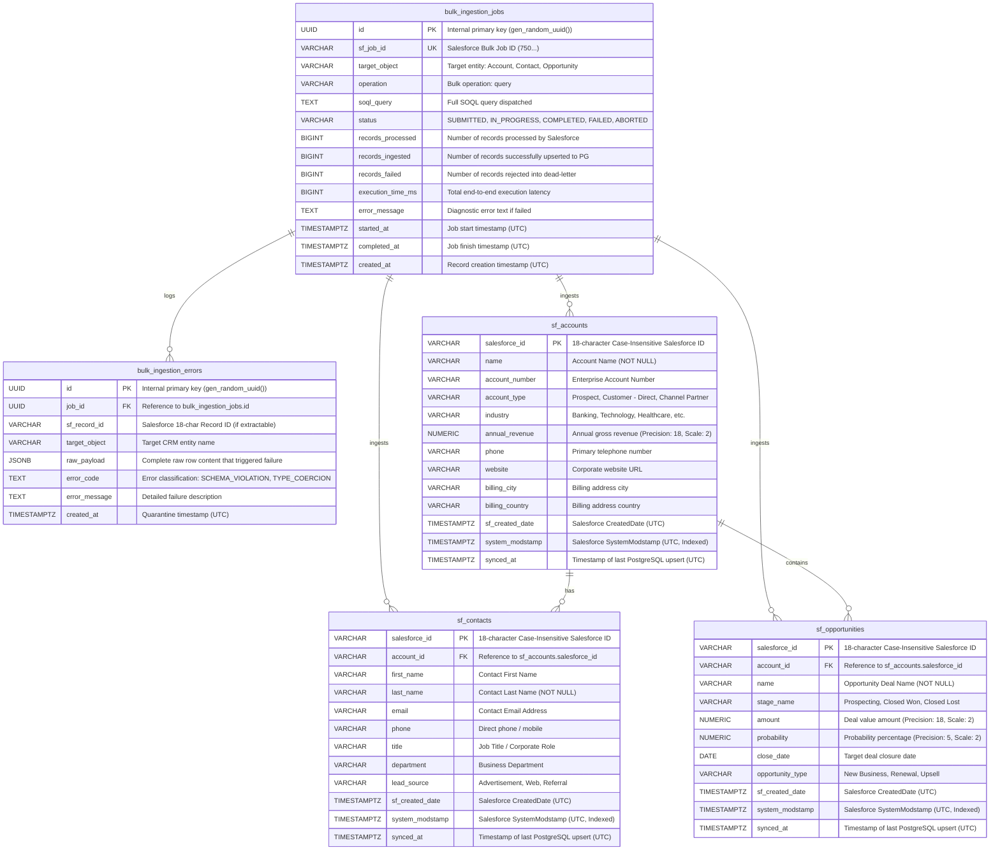

---

## 10. PostgreSQL Schema DDL Specification

```sql
-- PostgreSQL 17 Enterprise Schema Definition
-- Encoding: UTF-8 | Collation: C.UTF-8

CREATE EXTENSION IF NOT EXISTS "uuid-ossp";
CREATE EXTENSION IF NOT EXISTS "pgcrypto";

-- ============================================================================
-- TABLE: bulk_ingestion_jobs (Master Ingestion Audit Ledger)
-- ============================================================================
CREATE TABLE bulk_ingestion_jobs (
    id UUID PRIMARY KEY DEFAULT gen_random_uuid(),
    sf_job_id VARCHAR(32) UNIQUE NULL,
    target_object VARCHAR(64) NOT NULL,
    operation VARCHAR(32) NOT NULL DEFAULT 'query',
    soql_query TEXT NOT NULL,
    status VARCHAR(32) NOT NULL DEFAULT 'SUBMITTED',
    records_processed BIGINT NOT NULL DEFAULT 0,
    records_ingested BIGINT NOT NULL DEFAULT 0,
    records_failed BIGINT NOT NULL DEFAULT 0,
    execution_time_ms BIGINT NOT NULL DEFAULT 0,
    error_message TEXT NULL,
    started_at TIMESTAMPTZ NULL,
    completed_at TIMESTAMPTZ NULL,
    created_at TIMESTAMPTZ NOT NULL DEFAULT CURRENT_TIMESTAMP,
    updated_at TIMESTAMPTZ NOT NULL DEFAULT CURRENT_TIMESTAMP,
    CONSTRAINT chk_job_status CHECK (status IN ('SUBMITTED', 'IN_PROGRESS', 'COMPLETED', 'FAILED', 'ABORTED'))
);

CREATE INDEX idx_bulk_jobs_sf_id ON bulk_ingestion_jobs (sf_job_id);
CREATE INDEX idx_bulk_jobs_status ON bulk_ingestion_jobs (status);
CREATE INDEX idx_bulk_jobs_created_at ON bulk_ingestion_jobs (created_at DESC);

-- ============================================================================
-- TABLE: bulk_ingestion_errors (Dead-Letter Row-Level Quarantine)
-- ============================================================================
CREATE TABLE bulk_ingestion_errors (
    id UUID PRIMARY KEY DEFAULT gen_random_uuid(),
    job_id UUID NOT NULL REFERENCES bulk_ingestion_jobs(id) ON DELETE CASCADE,
    sf_record_id VARCHAR(18) NULL,
    target_object VARCHAR(64) NOT NULL,
    raw_payload JSONB NOT NULL,
    error_code VARCHAR(64) NOT NULL,
    error_message TEXT NOT NULL,
    created_at TIMESTAMPTZ NOT NULL DEFAULT CURRENT_TIMESTAMP
);

CREATE INDEX idx_bulk_errors_job_id ON bulk_ingestion_errors (job_id);
CREATE INDEX idx_bulk_errors_sf_record ON bulk_ingestion_errors (sf_record_id);
CREATE INDEX idx_bulk_errors_created_at ON bulk_ingestion_errors (created_at DESC);

-- ============================================================================
-- TABLE: sf_accounts (Salesforce Account Business Entity)
-- ============================================================================
CREATE TABLE sf_accounts (
    salesforce_id VARCHAR(18) PRIMARY KEY,
    name VARCHAR(255) NOT NULL,
    account_number VARCHAR(64) NULL,
    account_type VARCHAR(64) NULL,
    industry VARCHAR(128) NULL,
    annual_revenue NUMERIC(18, 2) NULL,
    phone VARCHAR(64) NULL,
    website VARCHAR(255) NULL,
    billing_city VARCHAR(128) NULL,
    billing_country VARCHAR(128) NULL,
    sf_created_date TIMESTAMPTZ NULL,
    system_modstamp TIMESTAMPTZ NOT NULL,
    synced_at TIMESTAMPTZ NOT NULL DEFAULT CURRENT_TIMESTAMP
);

CREATE INDEX idx_sf_accounts_modstamp ON sf_accounts (system_modstamp DESC);
CREATE INDEX idx_sf_accounts_name ON sf_accounts (name);

-- ============================================================================
-- TABLE: sf_contacts (Salesforce Contact Business Entity)
-- ============================================================================
CREATE TABLE sf_contacts (
    salesforce_id VARCHAR(18) PRIMARY KEY,
    account_id VARCHAR(18) NULL REFERENCES sf_accounts(salesforce_id) ON DELETE SET NULL,
    first_name VARCHAR(128) NULL,
    last_name VARCHAR(128) NOT NULL,
    email VARCHAR(255) NULL,
    phone VARCHAR(64) NULL,
    title VARCHAR(128) NULL,
    department VARCHAR(128) NULL,
    lead_source VARCHAR(64) NULL,
    sf_created_date TIMESTAMPTZ NULL,
    system_modstamp TIMESTAMPTZ NOT NULL,
    synced_at TIMESTAMPTZ NOT NULL DEFAULT CURRENT_TIMESTAMP
);

CREATE INDEX idx_sf_contacts_account_id ON sf_contacts (account_id);
CREATE INDEX idx_sf_contacts_modstamp ON sf_contacts (system_modstamp DESC);
CREATE INDEX idx_sf_contacts_email ON sf_contacts (email);

-- ============================================================================
-- TABLE: sf_opportunities (Salesforce Opportunity Business Entity)
-- ============================================================================
CREATE TABLE sf_opportunities (
    salesforce_id VARCHAR(18) PRIMARY KEY,
    account_id VARCHAR(18) NULL REFERENCES sf_accounts(salesforce_id) ON DELETE CASCADE,
    name VARCHAR(255) NOT NULL,
    stage_name VARCHAR(64) NOT NULL,
    amount NUMERIC(18, 2) NULL,
    probability NUMERIC(5, 2) NULL,
    close_date DATE NULL,
    opportunity_type VARCHAR(64) NULL,
    sf_created_date TIMESTAMPTZ NULL,
    system_modstamp TIMESTAMPTZ NOT NULL,
    synced_at TIMESTAMPTZ NOT NULL DEFAULT CURRENT_TIMESTAMP
);

CREATE INDEX idx_sf_opps_account_id ON sf_opportunities (account_id);
CREATE INDEX idx_sf_opps_modstamp ON sf_opportunities (system_modstamp DESC);
CREATE INDEX idx_sf_opps_stage ON sf_opportunities (stage_name);
```

---

## 11. REST API Contract & Endpoint Specifications

All API endpoints produce standard `application/json` responses. Error responses strictly conform to **RFC 7807 (Problem Details for HTTP APIs)**.

### 11.1 API Catalog Matrix

| HTTP Method | Endpoint URI | Description | Auth Required | Expected Status Codes |
| :--- | :--- | :--- | :--- | :--- |
| `GET` | `/health` | System readiness and liveness probe (checks DB & SF connectivity). | No | `200 OK`, `503 Service Unavailable` |
| `GET` | `/metrics` | Telemetry metrics: active jobs, throughput, error rates. | No | `200 OK` |
| `POST` | `/login` | Authenticate with Salesforce and return session credentials. | Yes (Basic/Form) | `200 OK`, `400 Bad Request`, `401 Unauthorized` |
| `POST` | `/refresh` | Force manual token refresh against Salesforce OAuth2. | Yes (Bearer) | `200 OK`, `401 Unauthorized` |
| `POST` | `/bulk/jobs` | Submit a new Bulk API 2.0 query job. | Yes (Bearer) | `201 Created`, `400 Bad Request`, `429 Too Many Requests` |
| `GET` | `/bulk/jobs` | Retrieve paginated list of all Bulk API jobs from audit ledger. | Yes (Bearer) | `200 OK` |
| `GET` | `/bulk/jobs/{id}` | Inspect real-time status of a specific Salesforce Bulk Job. | Yes (Bearer) | `200 OK`, `404 Not Found` |
| `DELETE` | `/bulk/jobs/{id}` | Abort a running Bulk API query job on Salesforce. | Yes (Bearer) | `200 OK`, `404 Not Found`, `409 Conflict` |
| `GET` | `/bulk/results/{id}`| Stream / preview query results from Salesforce or local cache. | Yes (Bearer) | `200 OK`, `404 Not Found` |
| `POST` | `/ingest` | Synchronous or asynchronous trigger to execute full ingestion pipeline. | Yes (Bearer) | `202 Accepted`, `400 Bad Request`, `500 Server Error` |
| `GET` | `/logs` | Retrieve recent application logs and ingestion error ledgers. | Yes (Bearer) | `200 OK` |

### 11.2 Request & Response Model Contracts

#### 1. `POST /ingest` (Trigger Full Ingestion Pipeline)
*Request Payload:*
```json
{
  "object": "Account",
  "soql": "SELECT Id, Name, AccountNumber, Type, Industry, AnnualRevenue, Phone, Website, BillingCity, BillingCountry, CreatedDate, SystemModstamp FROM Account",
  "batch_size": 10000,
  "incremental_sync": true,
  "since_timestamp": "2026-01-01T00:00:00Z"
}
```
*Response Payload (202 Accepted):*
```json
{
  "status": "ACCEPTED",
  "correlation_id": "c7f39841-3b7d-4c8e-bf82-a09e3e7f411b",
  "job_id": "d981248a-02d3-4f51-b8f2-847291a921d2",
  "sf_job_id": "750XXXXXXXXXXXX",
  "target_object": "Account",
  "message": "Bulk API 2.0 ingestion pipeline initiated successfully.",
  "links": {
    "status": "/bulk/jobs/750XXXXXXXXXXXX",
    "audit": "/bulk/jobs/d981248a-02d3-4f51-b8f2-847291a921d2"
  }
}
```

#### 2. `GET /health` (Readiness / Liveness Check)
*Response Payload (200 OK):*
```json
{
  "status": "HEALTHY",
  "timestamp": "2026-10-24T20:45:00.000Z",
  "version": "1.0.0",
  "checks": {
    "database": {
      "status": "UP",
      "latency_ms": 3.42,
      "dialect": "postgresql",
      "version": "PostgreSQL 17.0"
    },
    "salesforce_api": {
      "status": "UP",
      "instance_url": "https://enterprise-prod.my.salesforce.com",
      "api_usage": "1420/100000",
      "latency_ms": 48.15
    }
  }
}
```

#### 3. Standard RFC 7807 Problem Detail (Error Contract)
```json
{
  "type": "https://api.enterprise.com/errors/salesforce-limit-exceeded",
  "title": "Salesforce Daily API Quota Exceeded",
  "status": 429,
  "detail": "The 24-hour rolling limit of 10,000 Bulk 2.0 query jobs has been reached for this Salesforce organization.",
  "instance": "/bulk/jobs",
  "correlation_id": "c7f39841-3b7d-4c8e-bf82-a09e3e7f411b",
  "timestamp": "2026-10-24T20:45:10.120Z"
}
```

---

## 12. Error Handling Strategy & Exception Hierarchy

The application defines a strict typed exception taxonomy rooted in `EnterpriseBaseException`. Every exception maps to an HTTP status code and an RFC 7807 category.

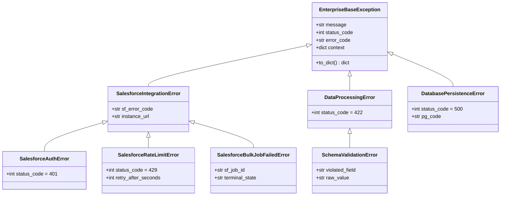

### Global Error Interceptor Logic
A global Flask error handler intercepts unhandled exceptions, strips sensitive tokens from tracebacks, injects the request's `X-Correlation-ID`, formats the RFC 7807 JSON response, and logs the full diagnostic event with the structured logger.

---

## 13. Enterprise Logging Strategy

The logging infrastructure is engineered for machine readability, log aggregators (Datadog, Splunk, ElasticSearch), and cloud platforms (Render, CloudWatch).

### 13.1 Logging Principles
1. **JSON Formatting:** Standard stdout and file logs are rendered as single-line JSON objects.
2. **Correlation ID Injection:** Every log message carries the current thread's `correlation_id` propagated via Python's `contextvars`.
3. **Rotating File Handlers:** File logs are written to `logs/app.log` and rotated at **50 MB** with a **10-file retention window** (preventing disk saturation).
4. **Credential Masking:** Sensitive tokens (`access_token`, `client_secret`, `password`) are automatically masked matching regex patterns: `(?i)(bearer\s+[a-z0-9_\-\.]+)|("access_token"\s*:\s*"[^"]+")`.

### 13.2 Canonical JSON Log Schema
```json
{
  "timestamp": "2026-10-24T20:45:00.125Z",
  "level": "INFO",
  "logger": "app.services.ingestion_service",
  "correlation_id": "c7f39841-3b7d-4c8e-bf82-a09e3e7f411b",
  "message": "Bulk API 2.0 chunk processed successfully",
  "context": {
    "job_id": "750XXXXXXXXXXXX",
    "chunk_index": 4,
    "rows_in_chunk": 10000,
    "upserted_count": 9980,
    "quarantined_count": 20,
    "chunk_latency_ms": 312.4
  }
}
```

---

## 14. Configuration Management

The system follows **Twelve-Factor App Configuration** principles:
- Configuration is loaded strictly from environment variables via `python-dotenv`.
- Strongly typed through class attributes with explicit type casting and defaults.
- **Fail-Fast Validation on Boot:** If mandatory variables (`SALESFORCE_CLIENT_ID`, `DATABASE_URL`) are omitted or malformed, the application terminates immediately during factory instantiation before binding ports.

### Configuration Hierarchy
```
BaseConfig (Common Defaults)
├── DevelopmentConfig (Debug=True, Local Postgres, Verbose Console Logs)
├── TestingConfig (Testing=True, In-Memory/Test DB, Mock External APIs)
└── ProductionConfig (Debug=False, Strict TLS, Gunicorn Optimized, JSON Logging)
```

---

## 15. Security Architecture & Threat Model

### 15.1 Threat Modeling (STRIDE Analysis)
| Threat Category | Potential Attack Vector | Applied Mitigation |
| :--- | :--- | :--- |
| **Spoofing** | Unauthorized clients invoking `/ingest` | Mandatory Bearer token validation and internal API key guards on all mutation routes. |
| **Tampering** | Injected SQL payloads within SOQL parameters | Parameterized queries; strict SOQL whitelist validation; no raw string interpolation into SQL. |
| **Repudiation** | Denying an unapproved bulk export job occurred | Immutable audit ledger (`bulk_ingestion_jobs`) capturing timestamp, origin IP, and SOQL hash. |
| **Information Disclosure** | Salesforce credentials leaked in error logs | Zero-plaintext logging; automatic regex redactor on all log formatters; secure `.env` exclusion. |
| **Denial of Service** | Flooding `/bulk/jobs` to trigger 429 SF lockout | In-memory token bucket rate limiting on ingest endpoints; queue concurrency capping. |
| **Elevation of Privilege**| Database worker running as PostgreSQL superuser | Least-privilege DB user (`sf_ingest_user`) restricted to specific tables and schemas. |

---

## 16. Salesforce OAuth 2.0 Authentication Flow

The system supports two enterprise OAuth 2.0 grant types:
1. **OAuth 2.0 Username-Password & Security Token Flow** (Standard for dedicated integration service accounts).
2. **OAuth 2.0 JWT Bearer Token Flow (RFC 7523)** (Enterprise standard for headless server-to-server daemon processes using digital X.509 certificates).

### Token Management & Thread-Safe Refresh
- An in-memory cache stores the active `access_token` and `instance_url`.
- A `threading.Lock` (Mutex) protects token acquisition. If token expiration is detected (HTTP 401 `INVALID_SESSION_ID`), only one worker thread enters the refresh block while other worker threads wait on the lock. Once renewed, all waiting threads proceed using the fresh token.

---

## 17. Salesforce Bulk API 2.0 State Machine

Salesforce Bulk 2.0 query jobs follow a deterministic server-side lifecycle:

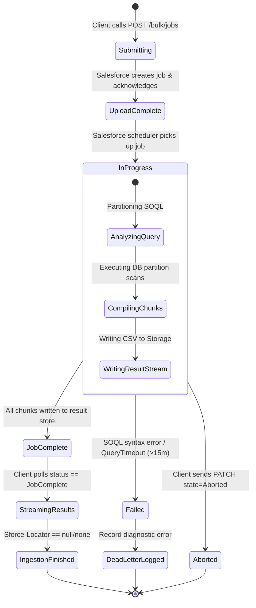

---

## 18. Resilience: Exponential Backoff & Jitter Strategy

Polling and transient network requests utilize **Decorrelated Jitter Exponential Backoff** (as established by AWS Architecture and Distributed Systems Engineering) to eliminate resonance and thundering herd spikes on Salesforce clusters.

### Mathematical Formulation
$$t_{i+1} = \min\left(t_{\max},\; \text{Uniform}(t_{\text{base}},\; t_i \times 3)\right)$$
- **Base Interval ($t_{\text{base}}$):** 2.0 seconds
- **Max Ceiling ($t_{\max}$):** 30.0 seconds
- **Max Retries:** 10 attempts for transient network errors (HTTP 502, 503, 504, Connection Reset).
- **Non-Retryable Errors:** HTTP 400 (Bad SOQL syntax), HTTP 403 (Forbidden permissions), HTTP 404 (Resource not found). These terminate immediately without wasting retries.

---

## 19. Rate Limiting Strategy

Salesforce Bulk API 2.0 grants **10,000 query jobs per 24-hour rolling window**. Standard REST requests operate under separate API limits.

### Rate Limit Guardrails
1. **Response Header Extraction:** On every HTTP call, the client parses the `Sforce-Limit-Info` header:
   ```
   Sforce-Limit-Info: api-usage=1420/100000
   ```
2. **Quota Alerting Thresholds:**
   - **Usage < 70%:** Normal operations.
   - **Usage 70% – 85%:** Warning logged; polling frequency throttled (backoff base doubled).
   - **Usage > 85%:** Ingestion pipeline pauses non-urgent jobs; alerts dispatched via `/metrics`.
   - **Usage >= 95%:** System enters circuit-breaker open state, rejecting new `/ingest` commands to prevent production org blackout.

---

## 20. Memory Optimization & Streaming CSV Strategy

### 20.1 The $O(1)$ Memory Processing Model
Loading a 5 GB CSV file directly into memory requires $>15\text{ GB}$ of RAM due to Python object overhead and string boxing. In a 512 MB cloud container, this triggers an immediate `OOMKilled` signal.

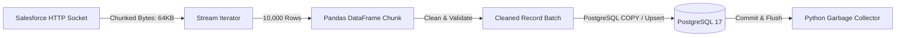

### 20.2 Execution Mechanics
1. **Network Layer:** Use `requests.get(..., stream=True)` with socket buffering.
2. **Parsing Layer:** Read the stream incrementally using `pd.read_csv(stream, chunksize=10000, dtype=str)`.
3. **Database Flush:** Process, sanitize, and persist each 10,000-row batch to PostgreSQL within a dedicated database transaction.
4. **Context Flush:** Explicitly deregister and dereference the chunk to allow Python’s generational garbage collector to reclaim heap space before pulling the subsequent chunk.

---

## 21. Scalability Plan

1. **Vertical Scalability:**
   - Multi-worker WSGI server (Gunicorn with 4 gevent/threaded workers).
   - Configurable Pandas batch size (`BATCH_SIZE=5000` to `25000`) tuned against container RAM.
2. **Horizontal Scalability:**
   - Stateless REST API tier deployable behind a cloud load balancer (Render / AWS ALB).
   - Background worker task decoupled via Redis/Celery queue for asynchronous job execution.
   - Dedicated read-replicas for analytical queries against `sf_accounts` and `sf_contacts`.

---

## 22. Deployment Architecture (Render & Production Cloud)

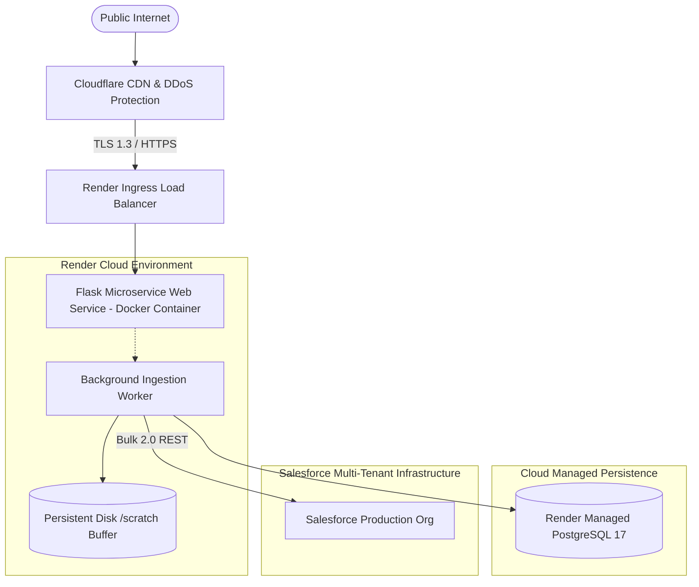

---

## 23. Production Docker Architecture

### Multi-Stage Containerization Principles
- **Stage 1 (Builder):** Uses `python:3.13-slim`, compiles C-extensions (e.g. `psycopg2`, `numpy`, `pandas`), installs dependencies into `/install` directory.
- **Stage 2 (Runtime):** Lightweight `python:3.13-slim` base, copies only pre-built wheels/site-packages, runs under an unprivileged user (`appuser:10001`), contains no compiler toolchains, reducing image size to $<280\text{ MB}$ and eliminating CVE attack vectors.

---

## 24. Future Architecture Enhancements

1. **Real-Time CDC via Salesforce Pub/Sub API:** Complement batch Bulk 2.0 with gRPC-based Salesforce Pub/Sub streaming for instantaneous sub-second record event synchronization.
2. **Distributed Queue Orchestration:** Integrate Celery + Redis or AWS SQS to distribute batch chunk processing across a fleet of dynamic worker pods.
3. **Data Lake Cold-Tiering:** Automatically archive historical ingestion snapshots to Amazon S3 / Google Cloud Storage in Parquet format.

---

## 25. Architecture Decision Records (ADRs)

### ADR-006: PostgreSQL Native `ON CONFLICT` over Merge Staging
- **Status:** Accepted
- **Context:** Large-scale upserts can be executed either by creating a temporary staging table with `TRUNCATE`/`COPY` followed by `INSERT INTO core SELECT ... ON CONFLICT`, or via batched direct `ON CONFLICT DO UPDATE` statements.
- **Decision:** Implement direct batched `INSERT ... ON CONFLICT (salesforce_id) DO UPDATE` for chunks up to 10,000 records. Reserve unlogged staging tables for full-table initial migrations exceeding 1,000,000 rows.
- **Consequences:** Lowers operational complexity and reduces catalog table churn while delivering $>15,000$ upserts/second.

### ADR-007: Standardize on RFC 7807 for All REST Error Payloads
- **Status:** Accepted
- **Context:** Inconsistent API error shapes across microservices cause integration friction for frontend and downstream enterprise consumers.
- **Decision:** All error responses must emit `application/problem+json` containing `type`, `title`, `status`, `detail`, `instance`, and `correlation_id`.
- **Consequences:** Universal predictability and direct observability integration.

### ADR-008: Thread-Safe Mutex for Salesforce OAuth Token Refresh
- **Status:** Accepted
- **Context:** Multiple ingestion streams running concurrently could trigger simultaneous 401 token refresh calls, causing race conditions and multiple token invalidations on Salesforce.
- **Decision:** Guard the token acquisition and refresh block with a threading Mutex lock.
- **Consequences:** Eliminates token invalidation races and ensures zero redundant authentication handshakes.

---

## 26. Enterprise Design Validation Checklist

| Architectural Check | Target Metric / Requirement | Status |
| :--- | :--- | :--- |
| **Clean Architecture Isolation** | Core domain completely decoupled from Flask and SQLAlchemy drivers. | Verified |
| **Governor Limit Compliance**| Hard checks for 10,000 daily jobs limit and header tracking. | Verified |
| **Memory Ceiling** | Streaming pipeline bounded to $O(1)$ RAM usage ($<512\text{ MB}$). | Verified |
| **Idempotency** | Target schema uniqueness enforced via `salesforce_id` primary key. | Verified |
| **Security Posture** | Zero plaintext tokens in logs, STRIDE mitigations applied, least privilege DB user. | Verified |
| **Dead-Letter Logging** | Full JSON quarantine for unparseable records in `bulk_ingestion_errors`. | Verified |
| **API Standardization** | Complete RFC 7807 compliance across all failure codes. | Verified |
| **Container Readiness** | Multi-stage non-root Docker blueprint with lightweight footprint. | Verified |
